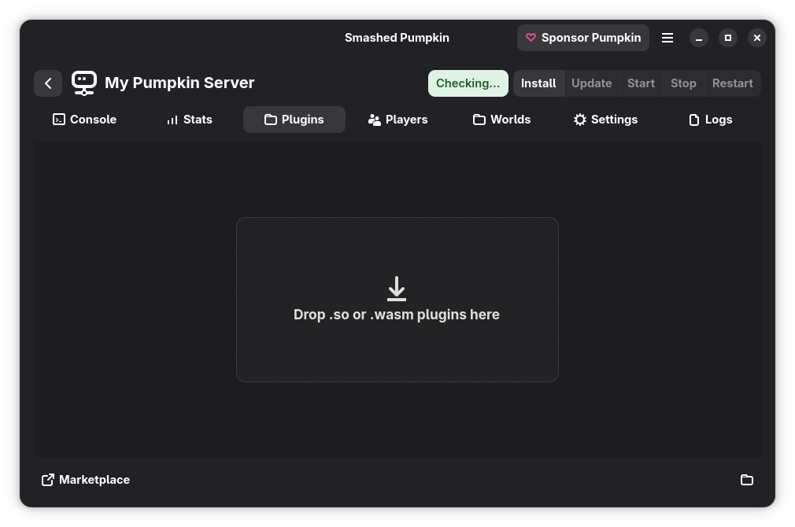
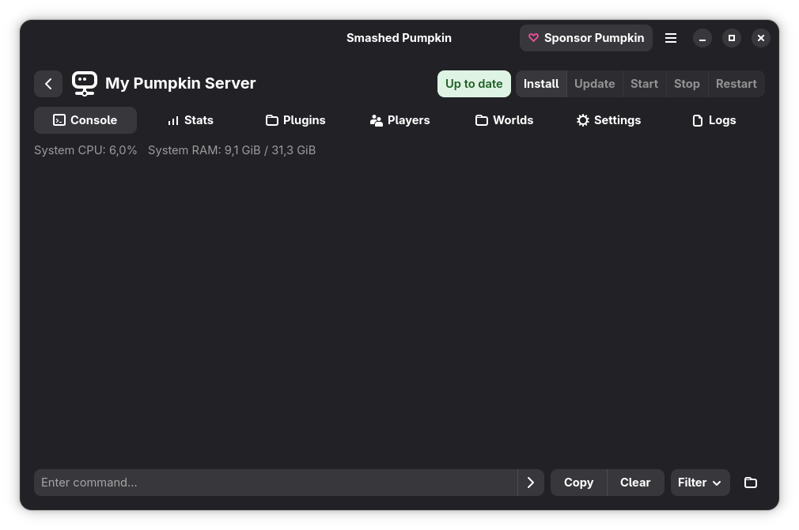

# Smashed Pumpkin

A Linux app for managing [Pumpkin](https://pumpkinmc.org/) Minecraft servers.
Built with GTK 4 and libadwaita, with server controls, plugins, players and worlds
in one native interface. Free software under GPL-3.0-or-later.

## Install

Get Smashed Pumpkin from [Flathub](https://flathub.org/apps/dev.rotstein.SmashedPumpkin).

```bash
flatpak install flathub dev.rotstein.SmashedPumpkin
flatpak run dev.rotstein.SmashedPumpkin
```

[GitHub Releases](https://github.com/Rotstein007/smashed-pumpkin/releases)
also provide Flatpak bundles for x86_64 and aarch64. Install a downloaded bundle
with `flatpak install ./SmashedPumpkin-x86_64.flatpak`, or use the aarch64 file
on an ARM64 system.

## Manage Your Servers

Install and update Pumpkin, start or stop servers, and group them into networks.
The console supports commands and colored log levels. Each server start creates
a separate session log. CPU, memory and TPS graphs help keep track of performance.

Manage players, whitelist entries and bans. Browse the Pumpkin Marketplace,
install free plugins without an API key, or import local plugin files.
Plugins can be enabled, disabled, updated and removed. Installing while the
server runs is supported; restart the server to use the new plugin.

The optional minimap displays saved terrain and live player positions. Follow
a player across dimensions or open moderation actions directly from the map.

These descriptions cover the current source tree. Published builds may not yet
include all of the latest changes.

### Pumpkin Updates

Choose **Nightly** or **Stable** in the Application settings. Nightly is the
default. The channel applies to future server installations and updates;
switching does not replace an existing server automatically.

Update checks run every five minutes and pause during installations and updates.
Updates still follow the server's automatic update settings. Only compatible
published downloads are used. Back up worlds before changing channels,
particularly when moving from Nightly to Stable. Plugins may need a matching
Pumpkin SDK.

### Minimap

Enabling the map requires explicit consent. Its bundled local `map-bridge`
plugin supplies live player data and needs write access to its own data folder.
The map reads existing saved chunks without generating new terrain.

Turning it off stops map tasks, releases terrain held in memory and disables
the bridge for future server starts. A running server is asked to unload the
bridge. If that Pumpkin build cannot unload it, restart the server to finish
disabling it. Saved map tiles remain on disk for faster loading next time.

### Startup And Recovery

Application settings control starting with the system, background operation and
the initial window mode. New servers restart four seconds after an unexpected
exit. Normal stops do not trigger recovery. Existing recovery preferences are
preserved; the delay and automatic restart can be changed in server settings.

## Screenshots





More views are available on the [website](https://smashed-pumpkin.rotstein.dev/).

## Build On Linux

Requires a C compiler, Meson 1.3.2 or newer, Ninja, pkg-config, GNU gettext tools,
and development headers for GTK 4.12 or newer, libadwaita 1.5 or newer and
libsoup 3.4 or newer. Native glibc builds also require `localedef`, the `en_US`
locale source and the UTF-8 charmap (typically provided by a locale-source package).
These generate a bundled messages-only locale; users do not need matching German
or Chinese system locales.
GTK 3 and Ayatana AppIndicator are optional dependencies for the tray helper.

```bash
meson setup buildDir
meson compile -C buildDir
./buildDir/src/smashed-pumpkin
meson test -C buildDir --print-errorlogs
```

UI regressions additionally require Xvfb, Openbox, xauth, xprop and XTest
development files (`xvfb openbox xauth x11-utils libxtst-dev` on Debian/Ubuntu).
They use a private display, configuration and local Marketplace fixtures:

```bash
bash build-aux/test-window-ui-headless.sh buildDir all
bash build-aux/test-window-ui-headless.sh buildDir minimap
```

The harness keeps GTK warnings fatal and checks the toolkit before testing the
app. GTK 4.24.1 has a reproducible window/popover frame regression; the tested
GTK 4.22.5 / libadwaita 1.9.4 pair passes. Use compatible headers and libraries
in an isolated environment when system packages are affected. CI runs all eight
UI scopes; Meson's default test environment isolates desktop proxy/VFS/settings.

Uninstalled builds automatically discover translations from the build tree;
`SMASHED_PUMPKIN_LOCALEDIR` can point at another absolute catalog directory.

Language selection is in General settings → Display and time and takes effect on
the next launch without restarting servers. The first production Simplified Chinese
catalog covers core interface text; untranslated messages use English.

If Meson reports that an existing build directory uses an incompatible version,
run `meson setup --reconfigure buildDir` before compiling again.

Normal app builds use the bundled minimap component and do not require Rust.
To rebuild the bridge from `plugins/map-bridge`, install Rust and its WASI target:

```bash
rustup target add wasm32-wasip2
bash build-aux/build-map-bridge.sh
meson compile -C buildDir
```

The bridge uses locked dependencies and a pinned Pumpkin SDK. A server with a
different plugin API may require rebuilding against its matching SDK.

For an offline source build, extract `SmashedPumpkin-X.Y.Z-map-bridge-sources.tar.xz`
from the release into `plugins/map-bridge` with its top-level directory stripped. With
Cargo and the `wasm32-wasip2` standard library installed, configure Meson with
`-Dbuild_minimap_bridge=true`. This builds and embeds the bridge without network
access or changing the bundled binary in the source tree.

## Contribute

Report bugs or suggest improvements through
[GitHub Issues](https://github.com/Rotstein007/smashed-pumpkin/issues).
See [platform support](docs/platform-support.md) and
[the release pipeline](docs/release-pipeline.md) for build and publishing details.
The [website](https://smashed-pumpkin.rotstein.dev/) is maintained in its own
[repository](https://github.com/Rotstein007/smashed-website).

## License

[GPL-3.0-or-later](LICENSE).
